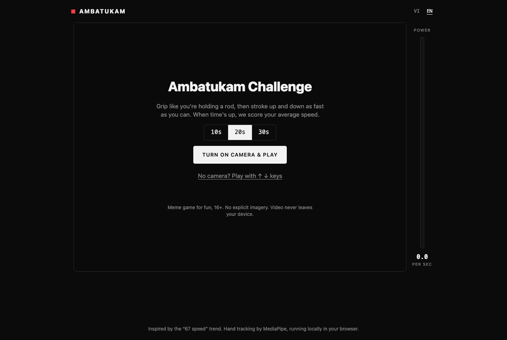
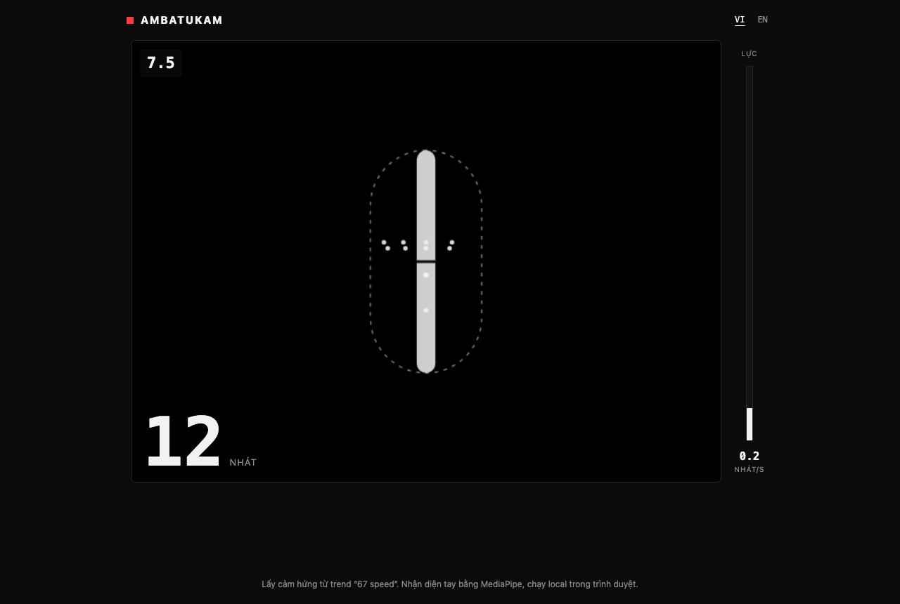
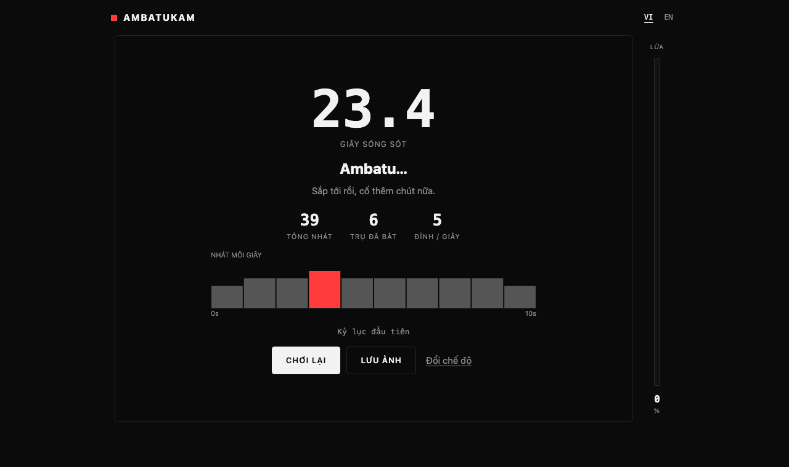

# Ambatukam Game

Game meme chơi bằng webcam: nắm tay như cầm một thanh trụ, xóc lên xuống thật nhanh. Có ba chế độ: đo tốc độ một tay, hai tay, và sống sót đuổi theo trụ ngẫu nhiên.

Toàn bộ nhận diện tay chạy trong trình duyệt, video không rời khỏi máy người chơi. Backend duy nhất là bảng xếp hạng (Cloudflare Workers + D1), chỉ nhận tên và điểm.

> Game giải trí lành mạnh cho 16+. Không có hình ảnh nhạy cảm. Mục đích: vui, theo trend, và vận động cơ tay.

**Chơi ngay:** https://ambatukam.bahao.site



## Chạy local

Frontend React + TypeScript (Vite), backend FastAPI chạy trên Cloudflare Python Workers + D1. Cần Node 22+ và [uv](https://docs.astral.sh/uv/) ≥ 0.13.4.

```bash
git clone https://github.com/NBaHao/ambatukam-game.git
cd ambatukam-game
make install                                   # npm ci + uv sync + tạo file env local từ *.example (khoá thử)
make migrate-local                             # tạo bảng D1 local (lần đầu)
make dev-api                                   # API + Worker: http://localhost:8787
make dev-web                                   # giao diện: http://localhost:5173 (mở cái này)
```

Trình duyệt chỉ cho mở camera trên `localhost` hoặc HTTPS. Biến môi trường, secret, quy ước code và cách deploy ghi ở [AGENTS.md](AGENTS.md).

Deploy: Cloudflare Workers Builds tự build và deploy khi push lên `main`. Deploy tay:

```bash
cd backend
uv run pywrangler login
openssl rand -hex 32 | uv run pywrangler secret put TOKEN_SECRET   # lần đầu
uv run pywrangler secret put TURNSTILE_SECRET                      # lần đầu
# sitekey: Build variable VITE_TURNSTILE_SITE_KEY trên Cloudflare (deploy tay: frontend/.env.production, đã gitignore)
cd .. && make deploy                                               # áp migration D1 còn thiếu rồi deploy
```

Toàn bộ nằm trong free tier của Cloudflare (Workers 100k request/ngày, D1 5 GB).

## Chế độ

| Chế độ | Cách chơi | Điểm |
|---|---|---|
| **Single** | 1 tay, 1 trụ. Đặt neo rồi xóc trong 10 / 20 / 30 giây | Lọ/giây trung bình |
| **Double** | 2 tay, 2 trụ. Cả hai tay cùng nắm và giữ yên để đặt hai neo, rồi xóc cả hai. Lọ hai tay cộng dồn | Lọ/giây trung bình (danh hiệu tính theo mỗi tay) |
| **Random** | Trụ hiện ở chỗ ngẫu nhiên, nghiêng ngẫu nhiên, và đổi chỗ sau 5 giây (giảm dần tới 2.5 giây). Phải nắm tay đuổi theo rồi xóc. Thanh **Lửa** cạn 10%/giây lúc đầu và cạn nhanh dần; mỗi lọ đúng trụ nạp 5%. Hết Lửa là dừng | Số giây sống sót |
| **PvP** | 1v1 qua link thách đấu, Single hoặc Double. Xem [PvP](#pvp) | Ai nhiều lọ hơn thắng |
| Rank | Sắp có | |

Kỷ lục lưu riêng cho từng chế độ (và từng mốc thời gian) trong `localStorage`.

## Bảng xếp hạng

Hết ván, popup kết quả hiện điểm và ô nhập tên để gửi điểm; gửi xong popup hiện hạng của bạn. Lần sau game nhớ tên và tự gửi. Mỗi máy giữ một dòng điểm cao nhất cho mỗi chế độ và mốc thời gian (định danh bằng mã ngẫu nhiên trong `localStorage`, không cần đăng nhập).

Điểm tính ở trình duyệt nên không chặn gian lận tuyệt đối được, server chỉ làm khó hơn (`backend/src/app/services/anticheat.py`, `routers/scores.py`):

- Lúc bắt đầu ván, server cấp token ký HMAC ghi lại thời điểm. Nộp điểm sớm hơn thời lượng ván (hoặc số giây sống sót), hoặc trễ quá 15 phút sau khi hết ván, là bị từ chối.
- Mỗi token chỉ dùng cho một ván (bảng `runs`). Nộp lại cùng token chỉ để đổi tên, phải cùng máy và cùng điểm.
- Client gửi kèm số lọ từng giây, FPS nhận diện và tỉ lệ bám trụ. Server đối chiếu: tổng từng giây phải khớp tổng lọ, trung bình tối đa 8 lọ/giây mỗi tay, giây nào cũng tối đa 10 lọ mỗi tay và không nhanh hơn FPS cho phép, số lọ phải tương xứng với thời gian bám trụ, nhịp đều tăm tắp như máy bị loại. Random: dựng lại thanh Lửa theo từng giây, Lửa đã cạn trước lúc thua là bịa.
- Cloudflare Turnstile xác minh người thật khi gửi điểm (thường chạy ngầm, chỉ hiện ô tick khi nghi ngờ), cộng giới hạn request theo IP.

Xem các ván đã nộp (số liệu từng ván nằm ở cột `detail`) và gỡ điểm đáng ngờ:

```bash
cd backend
uv run pywrangler d1 execute ambatukam-leaderboard --remote --command "SELECT r.*, s.name FROM runs r LEFT JOIN scores s USING (pid, mode, duration) ORDER BY r.created_at DESC LIMIT 20"
uv run pywrangler d1 execute ambatukam-leaderboard --remote --command "DELETE FROM scores WHERE pid = '<pid>'"
```

API (`backend/src/app/routers/`, tài liệu OpenAPI ở `/api/docs`):

| Endpoint | Việc |
|---|---|
| `POST /api/session` `{ mode, duration }` | Cấp token cho ván mới |
| `POST /api/score` `{ token, captcha, pid, name, strokes, survived?, bins, fps, grip, split? }` | Nộp điểm, trả về hạng hiện tại |
| `GET /api/leaderboard?mode=&duration=&pid=` | Top 50 và hạng của người chơi |
| `GET /api/users/{username}/exists` | Username box: log in or "want to join?" |
| `POST /api/auth/register` `{ username, password, email?, pid, captcha }` | Create an account, sets the session cookie |
| `POST /api/auth/login` `{ username, password }` | Log in, sets the session cookie |
| `POST /api/auth/logout` | Log out |
| `GET /api/me` | The logged-in account (or `null`), renews the session |
| `GET /api/users/{username}` | Public profile: best score per board with rank, PvP totals, latest 20 matches |
| `POST /api/rooms` `{ mode, duration, pid, name }` | Create a PvP room: `{ code, ticket }` |
| `POST /api/rooms/{code}/join` `{ pid, name }` | Ticket to join a room |
| `GET /api/rooms/{code}/ws?ticket=` | WebSocket to the room (Durable Object) |

## Accounts

Same model as TETR.IO, no OAuth or passkeys:

- One username box. Blank means guest: play and submit scores exactly as before.
- Unknown username: "want to join?" → stay anonymous, or register with a password (twice) and an optional email.
- Known username: password → log in. "I forgot" only explains that email reset isn't available yet.
- Registering moves the device's player id (and its scores) into the account. Logging in on another
  device switches that device to the account's player id; logging out gives it a fresh guest id.
- Logged-in scores always use the account's username. Guests can't submit under a registered username
  (compared after NFKC + casefold, so fullwidth look-alikes count as taken), or with a player id that
  belongs to an account. Registered players get a ✓ on the leaderboard.
- A blocked guest submit shows a "Log in" link in the result popup; after logging in, the same run is
  submitted under the account.

Passwords: PBKDF2-SHA256 through WebCrypto, `PW_ITERATIONS` in `backend/src/app/rules.py`
(each user row stores its own iteration count, logins re-hash with the current one, so raising it is safe).
Sessions: random token in an HttpOnly, Secure, SameSite=Lax cookie on `/api`; D1 stores only its SHA-256.
They last 30 days and `/api/me` renews them. Each login drops the account's expired sessions and keeps
only the newest `MAX_SESSIONS` (10).
Rate limits: register and login share a per-IP limit (`AUTH_LIMIT`); login also has a per-username
limit across all IPs (`LOGIN_NAME_LIMIT`, 10 per minute) against spread-out password guessing.

## Profiles

Every account has a public page at `/u/<username>`: best score on each board with its current rank, PvP
wins / losses / draws and the latest 20 matches (opponents who played logged in link to their own page).
Open it from the account menu (**My profile**), a ✓ name on the leaderboard, or the opponent's name in a
PvP result. Guests have no profile. The API returns no player ids, email or sign-in data.

## PvP

1v1 through a challenge link, both players on one clock:

1. PvP on the start screen → pick Single or Double and 10 / 20 / 30 s → **Create challenge link**.
   The page moves to `/c/<code>`; send that link to your opponent.
2. The opponent opens the link → **Join & start camera**. Both set their hands as usual (open hand,
   then grip and hold still), then wait for each other.
3. Once both are ready the server picks GO = now + 4.5 s and both clients count down to it
   (clock offset measured with ping/pong, lowest round-trip wins). Each side sees the other's live count.
4. When time is up each client sends its run; the server decides win / loss / draw, then **Rematch**
   or **Leave**. The room keeps the match score until someone else takes an empty seat.

How it works: each room is a Durable Object (`PvpRoom`, `backend/src/pvp_room.py`) holding the
WebSockets (hibernation API) and the state; the rules are plain Python in
`backend/src/app/services/room.py` (unit-tested without the DO). Joining needs a signed ticket from
`POST /api/rooms…` (HMAC with `TOKEN_SECRET`, 6 hours, bound to one room), which also carries the
player's name and whether it is an account. Logged-in players play under their username; guests
follow the same name rules as the leaderboard.

Anti-cheat for PvP is server-side and timed by the server: live counts must stay under the human limit
for the time elapsed and never go down, the final run must not arrive before GO + duration − 1.5 s, must
pass the same checks as a leaderboard run and can't be far above the last live count. A run that fails
counts as a loss (shown as "didn't count"); a player who sends nothing by GO + duration + 15 s forfeits.
Each round is stored in D1 (`matches`, `match_players`) for profiles and history.
PvP runs don't go to the leaderboard. No video or audio is exchanged.

## Cách chơi

1. Chọn chế độ, chọn thời gian (single / double), bấm **Bật camera & chơi**. Đây là lần bấm chuột duy nhất; từ đây điều khiển hoàn toàn bằng tay.
2. **Xòe bàn tay**, giữ 1 giây → sẵn sàng.
3. **Nắm tay như cầm trụ**, giữ yên 1 giây → game đặt **điểm neo** và vẽ thanh trụ ảo tại đó, nghiêng theo đúng hướng tay bạn đang nắm. (Double: cả hai tay cùng nắm. Random: bỏ qua bước này, trụ tự hiện.)
4. Đếm ngược 3-2-1, rồi **xóc lên xuống dọc theo trụ**. Chỉ những lọ đúng tư thế (tay nắm, nằm trong vùng trụ) mới được tính.
5. Hết giờ (hoặc hết Lửa): popup hiện tốc độ trung bình / số giây sống sót, danh hiệu, tổng lọ, kỷ lục, và ô gửi điểm lên bảng xếp hạng. **Xòe tay 1 giây** để chơi lại, hoặc bấm **Lưu ảnh** để tải ảnh kết quả 1080×1080.




## Cơ chế nhận diện

Mỗi khung hình, MediaPipe trả về 21 điểm khớp của bàn tay. Game tính:

| Thứ | Cách tính |
|---|---|
| Vị trí tay | Trung bình 5 điểm lòng bàn tay (cổ tay + 4 gốc ngón) |
| Cỡ tay | Khoảng cách cổ tay → gốc ngón giữa. Mọi ngưỡng khác đều tính theo cỡ này nên đứng gần/xa camera đều chơi được |
| Độ duỗi ngón | (cổ tay → đầu ngón) / (cổ tay → gốc ngón): ~1.0 khi co, ~1.9 khi duỗi, làm mượt qua các khung |
| Xòe tay | Cả 4 ngón duỗi |
| Nắm trụ | Trung bình độ duỗi 4 ngón < 1.45 (ngón trỏ thường duỗi hơn khi cầm trụ nên không xét từng ngón) |
| Buông trụ (khi chơi) | Từ 3 ngón duỗi thẳng trở lên |
| Trục trụ | Đường nối khớp ngón trỏ → khớp ngón út lúc đặt neo (làm mượt trong 1 giây giữ yên). Nắm trụ nghiêng thế nào thì trụ nghiêng thế ấy |
| Một lọ | Vị trí tay chiếu lên trục trụ đi về một phía rồi đảo chiều, biên độ tối thiểu 25% cỡ tay (hysteresis, chống rung). Chuyển động vuông góc với trụ không được tính |
| Bám trụ | Tay nắm, lệch khỏi trục < 0.9 cỡ tay và dọc trục < 1.8 cỡ tay so với điểm neo |
| Gán tay (double) | Mỗi khung, hai bàn tay nhận được ghép vào hai trụ theo khoảng cách gần nhất; lúc chưa có neo thì xếp theo chiều ngang |
| Trụ ngẫu nhiên | Cỡ trụ lấy theo cỡ tay đo được lúc xòe tay sẵn sàng, nên đứng gần/xa đều vừa tay |

Xóc nhanh làm tay bị nhòe và mô hình mất dấu vài khung. Trong 0.4 giây game giữ trạng thái gần nhất thay vì phạt; mất lâu hơn thì trụ chuyển xám và nhắc thêm ánh sáng.

Tất cả tham số nằm ở `frontend/src/game/constants.ts`, có chú thích từng dòng.

## Cấu trúc

```
frontend/   React + TypeScript (Vite). src/game là engine nhận diện tay, src/components là giao diện
backend/    FastAPI trên Cloudflare Python Workers: API bảng xếp hạng, chống gian lận, D1 migrations
docs/       Ảnh chụp màn hình
Makefile    Lệnh hay dùng: install, dev-api, dev-web, test, lint, build, deploy
AGENTS.md   Chi tiết cấu trúc, biến môi trường, quy ước, deploy
```

Thư viện MediaPipe đi kèm bundle, WASM và mô hình tải từ CDN lúc chạy.

## Ngôn ngữ

Có tiếng Việt và tiếng Anh, chuyển bằng nút VI / EN. Chuỗi nằm ở `frontend/src/i18n/strings.ts`; thêm ngôn ngữ mới = thêm một object cùng kiểu `Strings`.

## Âm thanh

Tiếng bíp và tiếng nổ nhỏ tổng hợp bằng Web Audio; giọng đọc, ba cú trầm và nhạc Top 10 là mẫu cắt sẵn ở `frontend/src/assets/audio`:

| File | Dài | Dùng khi |
|---|---|---|
| `hype.mp3` | 3.5s | bấm mascot ở màn bắt đầu |
| `finish.mp3` | 2.4s | kết ván, danh hiệu Ambatukam trở lên |
| `almost.mp3` | 1.2s | danh hiệu Ambatu… (code thêm tiếng xịt) |
| `celebrate.mp3` | 7.7s | lọt Top 10: nhạc + pháo hoa, pháo giấy |
| `countdown-three/two/one.mp3` | 0.67–0.82s | giọng đọc 3 · 2 · 1 |
| `countdown-go.mp3` | 0.75s | giọng hô GO |
| `countdown-tick.mp3` | 0.68s | cú trầm dưới mỗi số (cao dần) |
| `countdown-impact.mp3` | 2.2s | cú nổ ở GO, ngân sang mấy giây đầu của ván |
| `countdown-riser.mp3` | 2.45s | tiếng rít dâng suốt 3-2-1, đỉnh đúng lúc GO |

Dựng lại các mẫu:

```bash
npm run sound --prefix frontend -- /đường/dẫn/tới/thư-mục-gốc   # giọng meme, cần ffmpeg
npm run sound:countdown --prefix frontend                        # tải + cắt mẫu đếm ngược
```

Sửa mốc cắt trong script thì nghe lại và cập nhật `HYPE_HIT_AT` ở `src/game/audio.ts`. Cần xem trước hiệu ứng Top 10 khi chạy `make dev-web`: mở `?debug&auto=top10`.

## Debug

Khi chạy `make dev-web`, mở `http://localhost:5173/?debug` để có dòng chẩn đoán và `window.__amb` (bơm dữ liệu tay giả vào `processFrame`, `fakeHand`, `setMode`, đọc `phase`, `count`, `counts`, `anchors`, `onRod`, `meter`, `rods`).

Nhảy thẳng tới một màn hình để xem giao diện, thêm `mode=single|double|random`:

- `?debug&auto=play&mode=double&lang=vi`
- `?debug&auto=result&mode=random&lang=en`

## Ý tưởng tiếp theo

- Rank: chống gian lận chặt hơn bằng chuỗi thời điểm từng lọ
- PvP: matchmaking với người lạ, video/voice qua WebRTC
- Rhythm: xóc theo nhịp nhạc

## License

MIT

---

## English

Webcam meme game: grip like you're holding a rod, stroke up and down as fast as you can. Three modes: **Single** (1 hand, timed, average strokes/sec), **Double** (2 hands, 2 rods, strokes add up), **Random** (the rod spawns at random spots and keeps relocating; chase it to keep your Heat meter up, survive as long as you can). **PvP**: send a challenge link and race a friend on the same clock. Rank is coming soon.

Hand tracking runs entirely in the browser; video never leaves the device. The only backend is the leaderboard (Cloudflare Workers + D1), which receives just a name and a score. For fun, 16+, no explicit imagery.

**Play online:** https://ambatukam.bahao.site

**Stack:** React + TypeScript (Vite) in `frontend/`, FastAPI on Cloudflare Python Workers + D1 in `backend/`, served from one Worker.

**Run locally:** needs Node 22+ and uv ≥ 0.13.4. `make install` (also creates local env files from the `*.example` templates), `make migrate-local`, then `make dev-api` and `make dev-web` and open http://localhost:5173. Camera access requires `localhost` or HTTPS. Env vars, secrets, conventions and deploy are documented in [AGENTS.md](AGENTS.md).

**Leaderboard:** when a run ends, a result popup shows your score and a name field to submit it, then your rank. One best score per device per mode/duration. Scores are computed in the browser, so the server makes cheating harder rather than impossible: a one-time HMAC session token per run, a submit window, per-second stroke counts checked against the total, the camera frame rate, time spent on the rod and human limits (8 strokes/s per hand on average), a replay of the Heat meter in Random, Cloudflare Turnstile, and per-IP rate limits.

**Play:** pick a mode and duration → open palm 1s to get ready → grip and hold still 1s to set the anchor (both hands in Double; skipped in Random) → stroke along the virtual rod. Only strokes made while gripping inside the rod zone count. Open palm again to replay.

Switch language with the VI / EN toggle. All tuning constants are documented in `frontend/src/game/constants.ts`.
