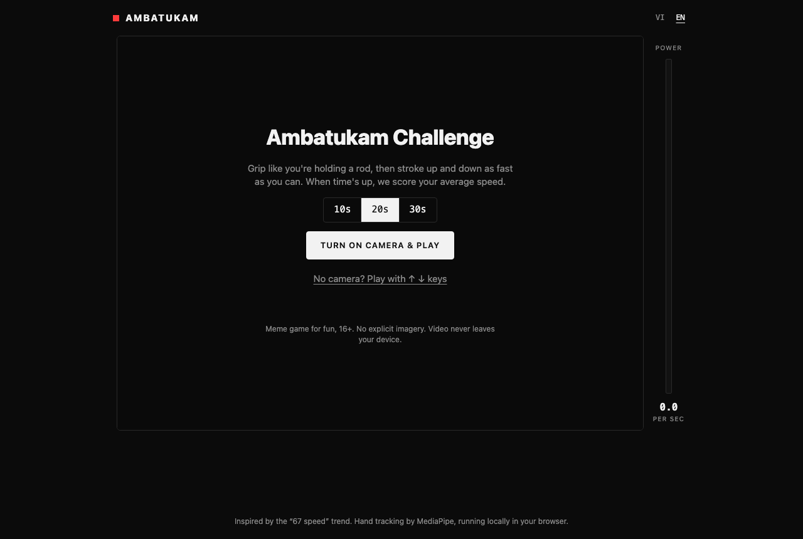
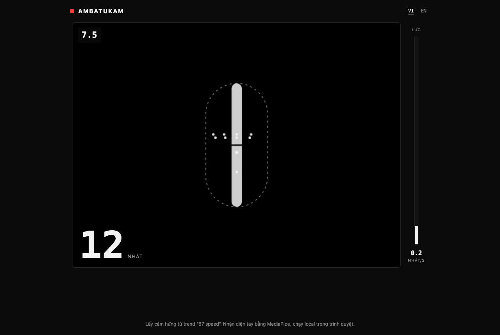
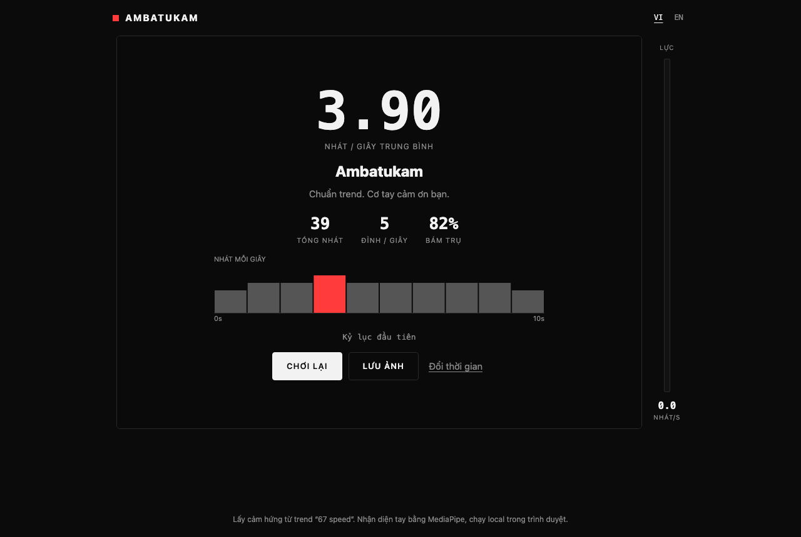

# Ambatukam Game

Game meme chơi bằng webcam: nắm tay như cầm một thanh trụ, xóc lên xuống thật nhanh. Hết giờ, game tính tốc độ trung bình (nhát/giây) và xếp danh hiệu.

Lấy cảm hứng từ trend "67 speed". Toàn bộ nhận diện tay chạy trong trình duyệt bằng [MediaPipe Hand Landmarker](https://ai.google.dev/edge/mediapipe/solutions/vision/hand_landmarker). Không có backend, video không rời khỏi máy người chơi.

> Game giải trí lành mạnh cho 16+. Không có hình ảnh nhạy cảm. Mục đích: vui, theo trend, và vận động cơ tay.



## Chạy local

Không cần cài gì. Chỉ cần một HTTP server tĩnh (trình duyệt không cho mở camera từ `file://`):

```bash
git clone <repo-url> ambatukam-game
cd ambatukam-game
python3 -m http.server 5173
```

Mở http://localhost:5173 rồi cho phép camera.

Cách khác nếu đã có Node: `npx serve .`

Khi đưa lên mạng phải dùng HTTPS (GitHub Pages, Vercel, Netlify… đều được), vì trình duyệt chỉ cho mở camera trên `localhost` hoặc HTTPS.

## Cách chơi

1. Chọn thời gian (10 / 20 / 30 giây), bấm **Bật camera & chơi**. Đây là lần bấm chuột duy nhất; từ đây điều khiển hoàn toàn bằng tay.
2. **Xòe bàn tay**, giữ 1 giây → sẵn sàng.
3. **Nắm tay như cầm trụ**, giữ yên 1 giây → game đặt **điểm neo** và vẽ thanh trụ ảo tại đó.
4. Đếm ngược 3-2-1, rồi **xóc lên xuống dọc theo trụ**. Chỉ những nhát đúng tư thế (tay nắm, nằm trong vùng trụ) mới được tính.
5. Hết giờ: xem tốc độ trung bình, tổng nhát, đỉnh, % thời gian bám trụ, biểu đồ từng giây. **Xòe tay 1 giây** để chơi lại, hoặc bấm **Lưu ảnh** để tải ảnh kết quả 1080×1080.

Không có camera? Có chế độ phím `↑` `↓` (hoặc chạm nửa trên / nửa dưới khung hình) để chơi thử.




## Cơ chế nhận diện

Mỗi khung hình, MediaPipe trả về 21 điểm khớp của bàn tay. Game tính:

| Thứ | Cách tính |
|---|---|
| Vị trí tay | Trung bình 5 điểm lòng bàn tay (cổ tay + 4 gốc ngón) |
| Cỡ tay | Khoảng cách cổ tay → gốc ngón giữa. Mọi ngưỡng khác đều tính theo cỡ này nên đứng gần/xa camera đều chơi được |
| Độ duỗi ngón | (cổ tay → đầu ngón) / (cổ tay → gốc ngón): ~1.0 khi co, ~1.9 khi duỗi, làm mượt qua các khung |
| Xòe tay | Cả 4 ngón duỗi |
| Nắm trụ | Trung bình độ duỗi 4 ngón < 1.45 (ngón trỏ thường duỗi hơn khi cầm trụ nên không xét từng ngón) |
| Buông trụ (khi chơi) | Từ 3 ngón duỗi thẳng trở lên |
| Một nhát | Tay đi xuống rồi đảo chiều đi lên, biên độ tối thiểu 25% cỡ tay (hysteresis, chống rung) |
| Bám trụ | Tay nắm, lệch ngang < 0.9 cỡ tay và lệch dọc < 1.8 cỡ tay so với điểm neo |

Xóc nhanh làm tay bị nhòe và mô hình mất dấu vài khung. Trong 0.4 giây game giữ trạng thái gần nhất thay vì phạt; mất lâu hơn thì trụ chuyển xám và nhắc thêm ánh sáng.

Tất cả tham số nằm ở đầu `game.js`, có chú thích từng dòng.

## Cấu trúc

```
index.html   Khung trang + các màn hình (start / ready / countdown / HUD / result)
style.css    Giao diện: đen trắng, một màu nhấn, không gradient
game.js      Toàn bộ logic: i18n, nhận diện tay, đếm nhát, vẽ overlay, chia sẻ
docs/        Ảnh chụp màn hình
```

Không có bước build. Thư viện MediaPipe và mô hình tải từ CDN lúc chạy.

## Ngôn ngữ

Có tiếng Việt và tiếng Anh, chuyển bằng nút VI / EN. Toàn bộ chuỗi nằm trong `STRINGS` ở đầu `game.js`; thêm ngôn ngữ mới = thêm một key.

## Debug

Mở `http://localhost:5173/?debug` để có `window.__amb` (bơm dữ liệu tay giả vào `processFrame`, đọc `state`, `count`, `anchor`, `onRod`).

Nhảy thẳng tới một màn hình để xem giao diện:

- `?debug&auto=play&lang=vi`
- `?debug&auto=result&lang=en`

## Ý tưởng tiếp theo

- Bảng xếp hạng toàn cầu (cần backend nhỏ + chống gian lận bằng chuỗi thời điểm từng nhát)
- Endurance: giữ thanh lực trên một mức càng lâu càng tốt
- Rhythm: xóc theo nhịp nhạc
- 1v1 qua WebRTC
- Chế độ 2 tay

## License

MIT

---

## English

Webcam meme game: grip like you're holding a rod, stroke up and down as fast as you can. When time's up you get your average strokes/sec and a rank.

Inspired by the "67 speed" trend. Hand tracking runs entirely in the browser with MediaPipe Hand Landmarker. No backend; video never leaves the device. For fun, 16+, no explicit imagery.

**Run locally:** any static server works, e.g. `python3 -m http.server 5173`, then open http://localhost:5173. Camera access requires `localhost` or HTTPS.

**Play:** pick a duration → open palm 1s to get ready → grip and hold still 1s to set the anchor → stroke along the virtual rod. Only strokes made while gripping inside the rod zone count. Open palm again to replay. Keyboard mode (`↑` `↓`) is available without a camera.

Switch language with the VI / EN toggle. All tuning constants are documented at the top of `game.js`.
